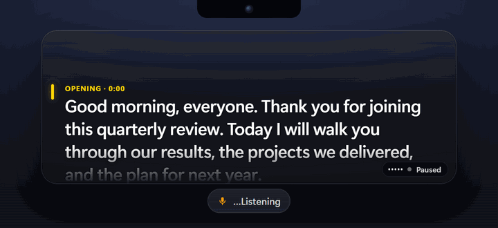
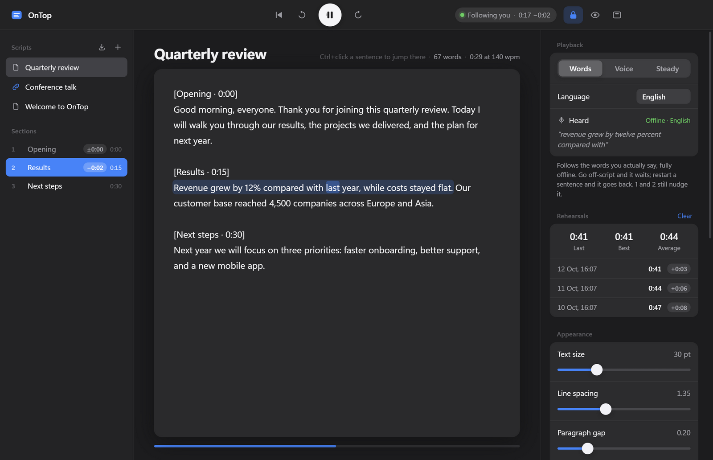

<p align="center">
  
</p>

<h1 align="center">OnTop</h1>

<p align="center">
  A free teleprompter that sits under your webcam, follows the words you say,<br>
  and stays invisible when you share your screen.
</p>

<p align="center">
  
</p>

OnTop puts your script in a slim glass strip at the top of your screen, right under the camera, so you keep eye contact on video calls, in recorded presentations and in interviews. It listens as you speak and keeps the line you are on next to the lens. Nobody on the call sees it, including in screen shares and recordings.

Everything runs on your computer. Speech recognition is offline and no audio leaves your machine.

## Features

- **Follows your words.** Offline speech recognition (Vosk) matches what you say against the script. Pause and it waits. Go off-script and it waits. Restart a sentence and it goes back. Skip a paragraph and it catches up.
- **Live, with almost no lag.** The recogniser only listens for the words in your script, so a word typically shows up about 0.1 s after you say it. If you stumble over a word it keeps moving with you, and the next recognised word puts it back on the exact spot.
- **Learns your voice.** A one-minute *Voice setup* measures your room and your voice, your speaking pace, and how the recogniser hears the names and acronyms in your script. If it hears *Northwind* as "north wind", that now counts as Northwind.
- **English, Portuguese and Spanish.** English is built in; Portuguese (31 MB) and Spanish (38 MB) download from the Vosk project the first time you pick them.
- **Invisible to screen share.** Both windows are excluded from screen capture (Teams, Zoom, Meet, OBS, recordings).
- **Stays out of the way.** The overlay is always on top, click-through when locked, and the text you have already read fades back.
- **Three modes.** *Words* follows your speech. *Voice* scrolls at your pace while you talk. *Steady* scrolls at a fixed speed.
- **Script library.** Keep several scripts. Import Markdown or text files; imported notes stay linked and update live when you edit the file (works well with Obsidian).
- **Sections and timing.** A heading like `## Slide 3, Results (1:30)` becomes a section you can jump to, with a planned start time. While you rehearse, OnTop shows whether you are ahead or behind plan, and keeps the time of every run.
<p align="center">
  
</p>

- **Keyboard first.** Global shortcuts work from any app, so you never have to click the prompter mid-presentation.

## Install

Download from [Releases](../../releases/latest):

| Platform | File | Notes |
|---|---|---|
| Windows 10 (2004+) / 11 | `OnTop-Setup-x.y.z.exe` | Installs for your user only, no admin rights. SmartScreen warns because the installer isn't code-signed yet: **More info → Run anyway**. |
| macOS, Apple Silicon | `OnTop-x.y.z-mac-arm64.dmg` | **Experimental.** Not notarized: after dragging OnTop to Applications, run `xattr -dr com.apple.quarantine /Applications/OnTop.app` once, then open it. |
| macOS, Intel | `OnTop-x.y.z-mac-x64.dmg` | Same as above. |

You need a microphone for the voice modes. Signing status and how to turn it on: [docs/CODE_SIGNING.md](docs/CODE_SIGNING.md).

## Use

1. Paste a script into the editor, or import a Markdown note with the ⤓ button.
2. Unlock the overlay (Ctrl+Alt+L), drag it under your camera, resize it, and lock it again.
3. Press play (Ctrl+Alt+P) and start talking.

### Writing a script

```text
[Opening · 0:00]
Good morning, everyone. Thank you for joining.

[Results · 0:15]
Revenue grew by 12% compared with last year. [pause] Costs stayed flat.
```

- A blank line starts a new paragraph.
- A line that is only `[Name · m:ss]` starts a section; the time is the planned start.
- Anything else in `[brackets]` is a cue: shown in colour, never read.

Markdown imports convert automatically: `#` is the script name, `##` to `######` headings become sections (`Slide 3, Results (1:30)` → `[Slide 3 · Results · 1:30]`), and blockquotes, frontmatter, tables, code and lines like `*(note to self)*` are left out.

### Shortcuts

| Keys | Action |
|---|---|
| Ctrl+Alt+P | Play / pause |
| Ctrl+Alt+L | Lock the overlay (click-through) / unlock to move and resize |
| Ctrl+Alt+H | Hide / show the overlay |
| Ctrl+Alt+← / → | Back / forward two lines |
| Ctrl+Alt+↑ / ↓ | Faster / slower (Voice and Steady modes) |
| Ctrl+Alt+Home | Back to the start |
| 1 / 2 | Up / down one line (can be turned off; while on, other apps don't receive 1 and 2) |
| Ctrl+click in the script | Jump the prompter to that sentence |

## How it works

| Piece | Approach |
|---|---|
| Overlay | Electron window: transparent, frameless, always on top, `setIgnoreMouseEvents` when locked |
| Hidden from capture | `setContentProtection(true)`, which is `SetWindowDisplayAffinity(WDA_EXCLUDEFROMCAPTURE)` on Windows |
| Lag | The recogniser gets a grammar of the script's words plus `[unk]`: on the test recording the median delay from a spoken word to its recognition fell from about 250 ms to 100 ms. Audio is captured at 16 kHz in 64 ms chunks |
| Speech | [vosk-browser](https://github.com/ccoreilly/vosk-browser) (WebAssembly) with the small Vosk models (English bundled; Portuguese and Spanish downloaded on demand into `%APPDATA%\OnTop\models`), fed from the microphone |
| Following | `src/tracker.js`: the last eight recognised words are aligned against a window of the script (Smith-Waterman with fuzzy word matching). Small moves need two solid matches; jumping back or far ahead needs stronger evidence. Numbers are spelled out per language ("12%" → "twelve percent", "doze por cento", "doce por ciento") |
| Library | Settings and scripts in `%APPDATA%\OnTop\settings.json`; linked files are watched and re-imported on change |

Prior art that shaped it: [Textream](https://github.com/f/textream) (word tracking, voice-activated mode), [autocue](https://github.com/EdNutting/autocue) (local speech recognition with fuzzy script matching).

## Develop

```bash
npm install
npm run fetch-model   # downloads the 40 MB English speech model into models/
npm start
```

| Command | What it does |
|---|---|
| `npm test` | Unit tests: tracker, Markdown importer, Portuguese and Spanish, Voice setup |
| `npm run test:track` | Plays `test/speech.wav` into the app and checks the tracker follows it (make the WAV with `powershell -File test/make-speech.ps1`) |
| `npm run test:library` | Links a temporary note, edits it, checks the script updates |
| `npm run test:setup` | Runs Voice setup end to end on recorded phrases and checks what it learns |
| `npm run smoke` | Opens both windows and writes screenshots to `smoke/` |
| `npm run dist` | Builds the Windows installer into `dist/` (`npm run dist:mac` on a Mac) |
| `npm run demo` | Re-records `docs/demo.gif` from the test speech |
| `OnTop.exe --selftest` | In an installed copy: checks the speech model loads and the shortcuts register |

Project layout: `src/main.js` (windows, shortcuts, library, timing), `src/overlay.*` (the prompter), `src/editor.*` (the editor), `src/tracker.js`, `src/script.js`, `src/markdown.js`.

## Limitations

- **macOS is experimental.** It is built automatically on a Mac in GitHub Actions but hasn't been tried by hand. Hiding from screen capture relies on macOS window sharing settings, which some capture tools on recent macOS versions ignore: check with your own call before relying on it.
- Word tracking supports English, Portuguese and Spanish. Other languages work in *Voice* and *Steady* modes. Portuguese and Spanish matching is unit-tested but has had less real-world use than English.
- Linux isn't packaged.
- Voice modes react to any voice the microphone hears. Use headphones on calls so other people's voices don't move your script.

## License

[MIT](LICENSE). Third-party components are listed in [THIRD_PARTY_NOTICES.md](THIRD_PARTY_NOTICES.md).
